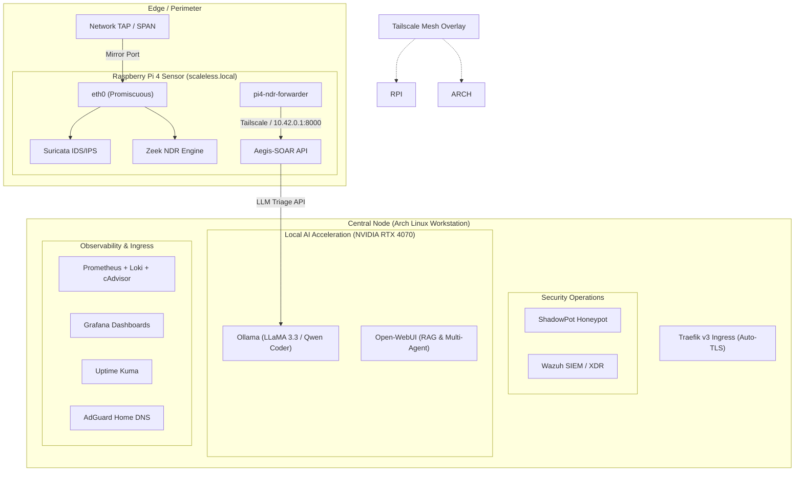

# 🛡️ Cutting-Edge SecOps Homelab & AI Command Center

A high-performance, security-focused hybrid homelab infrastructure orchestrated across an **Arch Linux Workstation (RTX 4070 12GB)** and a **Raspberry Pi 4 NDR Sensor (`scaleless`)**, backed by GitOps and infrastructure-as-code.

---

## 🏛️ Architecture & Nodes



---

## 📂 Repository Layout

```
homelab/
├── docker/
│   ├── ai/            # Ollama GPU pass-through + Open-WebUI
│   ├── monitoring/    # Prometheus, Grafana, Loki, Promtail, cAdvisor, Uptime Kuma
│   ├── security/      # Wazuh SIEM, Caldera adversary emulation
│   └── services/      # Traefik v3 reverse proxy, AdGuard Home DNS
├── ansible/           # Automations for PC & Raspberry Pi sensor
├── scripts/           # Management, backup (Restic), and diagnostic scripts
└── docs/              # System architecture specs and runbooks
```

## 🚀 Quickstart
```bash
# Bring up monitoring stack
cd docker/monitoring && docker compose up -d

# Bring up Traefik and AdGuard Home
cd ../services && docker compose up -d

# Bring up GPU-accelerated AI stack
cd ../ai && docker compose up -d
```
